# TAKT FLOW 사용자 매뉴얼

**기준 버전: 2.0.25 · 작성 기준일: 2026-10-21 · Windows / Ubuntu 공통**

처음 설치한 사용자부터 일정 공유와 말하기 연습을 함께 사용하는 사용자까지를 위한 안내입니다.
화면은 2.0.25에서 실제 사용자 자료와 분리한 예시 데이터로 캡처했습니다.
시작 화면 5개 모드 입구부터 간편 로그인, 저장·동기화·공유의 차이까지 실제 동작을 기준으로 정리했습니다.
날짜, 이름, 일정과 녹음 목록은 사용 예시이며 실제 업무 자료나 실제 답변 녹음이 아닙니다.
창 크기, 운영체제 배율, 테마에 따라 메뉴 위치와 화면에 보이는 항목 수는 달라질 수 있습니다.

이 문서의 `설정 > 창 꾸미기...` 같은 표기는 메뉴를 여는 순서입니다.
설치 방법은 [Ubuntu 설치 안내](https://github.com/TAKT-Flow/TAKT-FLOW/blob/main/설치-매뉴얼.md)를 참고하세요.
[English Quick Guide](#english)

**읽는 순서:** 처음이면 1장의 빠른 시작을 따라 해 보세요. 설정은 3장, 목적별 사용법은
4~8장, 일정·문서의 자세한 조작은 9~10장입니다. 다른 PC·팀원과 함께 쓰면 11장,
작은 창은 12장, 단축키는 13장, 백업과 문제 해결은 14장에서 찾을 수 있습니다.

이 문서에서 **모드**는 같은 프로그램의 화면 배치이고, **캘린더**는 일정을 나누어 담는 공간입니다.
화면에 **플래너**라고 쓰인 곳도 같은 캘린더를 뜻합니다. **할 일**은 완료 체크를 하는 항목,
**기록**은 완료할 필요 없이 남기는 일정, **문서 메모**는 날짜에 연결된 긴 글입니다.

## 목차

1. [처음 실행과 시작 화면](#start)
2. [공통 화면과 조작](#navigation)
3. [처음 맞춰 둘 설정](#settings)
4. [집중 타이머 모드](#focus)
5. [실전 말하기 연습 모드](#practice)
6. [업무 흐름 모드](#work)
7. [오늘 일정 정리 모드](#plan)
8. [모든 기능 보기와 일반 녹음](#all)
9. [일정·할 일의 세부 기능](#calendar-details)
10. [문서 메모와 태그](#documents)
11. [계정·자동 동기화·공유 캘린더](#sync)
12. [위젯 사용법](#widgets)
13. [단축키와 입력 규칙](#shortcuts)
14. [백업·업데이트·문제 해결](#recovery)

## 1. 처음 실행과 시작 화면

처음 실행하면 **회원가입 / 계정 없이 시작 / 이미 계정이 있나요? 로그인**을 선택합니다.
계정 없이도 이 기기에 자료를 저장할 수 있고, 로그인하면 일정·메모·말하기 기록의 기기 간 동기화가 추가됩니다.
녹음 파일과 기기별 설정은 동기화 대상이 아닙니다. 현재 결제 단계는 없습니다.
회원가입의 아이디·이메일·비밀번호는 한 창에서 입력합니다. 이메일 가입은 인증 메일 확인 후 로그인하고,
Google·카카오는 인증으로 로그인이 완료되면 다시 로그인하지 않습니다.
로그인 또는 계정 없이 시작을 선택하면 같은 창에서 **무엇을 먼저 할까요?** 모드를 고릅니다.
기능을 구매하거나 제한하는 선택이 아니라, 먼저 보여 줄 작업 화면을 고르는 단계입니다.
다음 실행부터 계정 선택과 모드 선택을 자동으로 다시 열지 않고 이전 화면을 복원합니다.
로그아웃·세션 만료·업데이트 후에도 시작 완료 기록은 유지합니다.
비회원 사용자가 나중에 로그인하려면 **프로필 > 계정 연결**을 사용합니다.

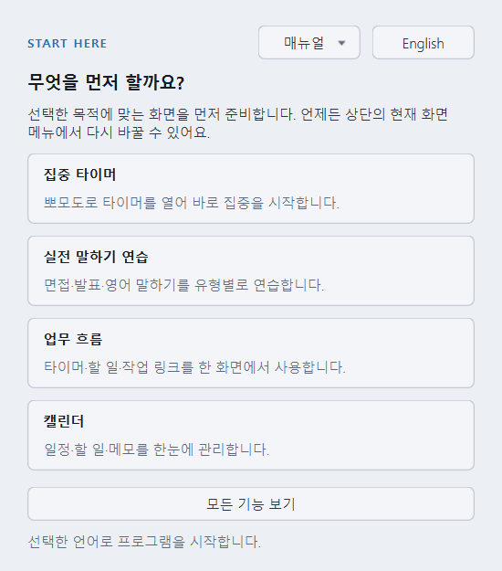

오른쪽 위 **English** 버튼을 누르면 제목·설명·선택 버튼이 영어로 바로 바뀝니다.
그 옆 **매뉴얼** 버튼에서 **GitHub에서 보기 / PDF 다운로드**를 선택할 수 있습니다.
매뉴얼을 열어도 모드는 선택되지 않으며, 읽은 뒤 시작 창으로 돌아와 작업 화면을 고르면 됩니다.
다시 **한국어**를 누르면 돌아옵니다. 언어 버튼 자체는 작업 화면을 선택하거나 창을 닫지 않습니다.
원하는 언어에서 아래 작업 화면을 선택하면 **프로그램도 그 언어로 시작**하며, 다음 실행에도 기억합니다.
첫 계정 선택 전에 닫으면 완료로 기록하지 않습니다. 계정 선택을 마친 뒤 모드 선택을 닫으면
모든 기능 보기로 시작합니다. 도움 메뉴에서 다시 연 모드 창의 취소는 기존 설정을 유지합니다.

| 선택 | 처음 열리는 화면 | 이런 경우에 선택하세요 |
|---|---|---|
| 집중 타이머 | 뽀모도로 타이머를 열어 바로 집중을 시작합니다. | 공부·업무에 집중할 시간을 정하고 싶을 때 |
| 실전 말하기 연습 | 면접·발표·영어 말하기를 유형별로 연습합니다. | 면접·발표·낭독·영어 말하기를 연습할 때 |
| 업무 흐름 | 타이머·할 일·작업 링크를 한 화면에서 사용합니다. | 집중 시간과 일정·링크를 함께 관리하고 싶을 때 |
| 캘린더 | 일정·할 일·메모를 한눈에 관리합니다. | 달력과 메모만 넓게 보고 싶을 때 |
| 모든 기능 보기 | 타이머·녹음·작업 링크·달력 | 기능을 둘러보거나 함께 사용하고 싶을 때 |

모드 입구는 위의 **5개**이며, 언어 전환 버튼은 별도입니다. **캘린더** 버튼은 기존
**오늘 일정 정리** 모드로 연결됩니다. 실행 후 상단 `현재 화면 > 오늘 일정 정리`에서
고르거나 `Ctrl+L`을 눌러도 같은 화면이 열립니다.
선택을 바꾸어도 이미 작성한 일정이나 녹음 기록이 삭제되지 않습니다.
시작 창을 다시 보려면 `도움 > 시작 화면 다시 보기`를 사용하세요.
사용 중 다시 연 시작 창에서 앱 언어를 바꾸면 편집·녹음 상태를 보호하기 위해 **다음 실행부터**
적용합니다. 작성 중인 내용을 마친 뒤 프로그램을 완전히 종료하고 다시 실행하세요.

처음 사용할 때는 목적을 고른 뒤, 말하기 연습을 할 경우 마이크를 확인하고,
다른 PC와 이어 쓸 경우 계정을 연결하면 됩니다. 계정 없이도 기본 기능은 로컬에서 사용할 수 있습니다.

### 1.1. 3분 빠른 시작: 할 일 하나 남기기

1. 시작 창에서 **캘린더**를 선택합니다. 이미 본창이라면 **Ctrl+L**을 누릅니다.
2. 달력 위 목록에서 **기본** 등 작성 가능한 개별 캘린더를 선택하고 날짜를 한 번 누릅니다.
3. 아래 **할 일**의 빈 줄에 `회의 준비`를 쓰고 **Enter**를 누릅니다. 다음 빈 줄로 이동하고 일정이 남으면 완료입니다.
4. 끝낸 일은 행 위에 마우스를 올려 **완료 표시**를 누릅니다. 완료 항목은 목록 아래로 내려갑니다.

처음에는 로그인이나 공유 설정 없이 이 과정을 해 볼 수 있습니다. 시간까지 넣고 싶다면 빈 줄에
`17:00 팀 회의`처럼 입력한 뒤 Enter를 누르거나, 날짜를 더블클릭해 정식 입력 창을 사용하세요.
다른 PC에서도 보려면 이 과정을 마친 뒤 [계정 연결과 자동 동기화](#sync)를 설정합니다.

## 2. 공통 화면과 조작

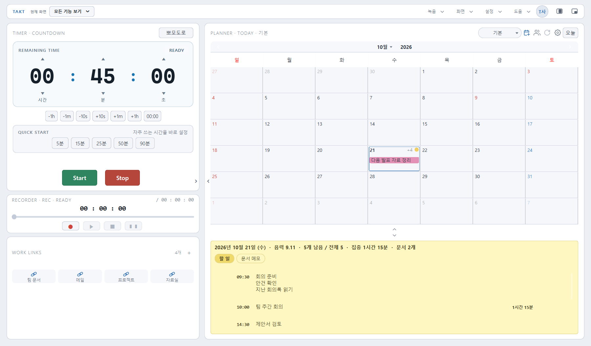

| 위치·메뉴 | 하는 일 |
|---|---|
| 현재 화면 | 집중 타이머 / 실전 말하기 연습 / 업무 흐름 / 오늘 일정 정리 / 모든 기능 보기 전환 |
| 전체 보기 | 목적별 간단 화면에서 모든 기능 보기로 돌아가기 |
| 녹음 | 새 녹음, 파일 열기·저장, 마이크 설정, 앱 종료 |
| 화면 | 타이머 방식, 시계 디자인, 패널 표시, 항상 위에 표시, 미니·달력·본창 위젯 |
| 설정 | 내 정보, 화면별 타이머, 창 꾸미기, 테마, 글씨 크기, 알림, 자동 실행, 백업, 사용자 매뉴얼 |
| 도움 | 시작 화면 다시 보기, 단축키, TAKT 정보, 사용자 매뉴얼, 개발자에게 피드백 |
| 원형 프로필 버튼 | 내 정보, 계정 연결·로그아웃, 동기화 상태와 초대함 확인 |

좁은 창에서는 녹음·화면·설정·도움 메뉴가 **더보기** 안에 묶입니다.
메뉴가 보이지 않는다고 기능이 제거된 것은 아닙니다. 아이콘에 마우스를 올리면 툴팁을 볼 수 있습니다.
`설정 > 사용자 매뉴얼 > GitHub에서 보기 / PDF 다운로드`는 현재 설치 버전에 맞는 문서를 기본 브라우저로 엽니다.
다운로드에는 인터넷이 필요하며, PDF는 내려받은 뒤 오프라인에서도 읽을 수 있습니다.
`도움 > 사용자 매뉴얼`에서도 같은 문서를 열 수 있습니다. `도움 > 개발자에게 피드백`은
피터랩 문의 주소 `peter.lab.contact@gmail.com`과 인터넷 없이 읽을 수 있는 기본 도움말을 표시합니다.
메일 작성은 기본 메일 앱을 열 뿐 자동 발송하지 않습니다. 메일 앱이 없으면 주소 복사를 사용하세요.
비밀번호·인증코드·개인 일정이나 전체 백업은 피드백에 포함하지 마세요.

업무 흐름과 모든 기능 보기에서는 두 열 사이 화살표로 왼쪽 타이머 영역이나 오른쪽 플래너를
접고 펼칩니다. 달력과 메모 사이의 위·아래 화살표는 **메모만 크게 보기 / 달력만 크게 보기**에
사용하며, 반대 방향 화살표를 누르면 돌아옵니다. 내용을 크게 볼 필요가 있을 때 먼저 활용하세요.

녹음·재생·답변 준비 중에는 일부 모드 전환이 막힙니다. 진행 중인 작업을 정지한 뒤 전환하세요.

## 3. 처음 맞춰 둘 설정

### 3.1. 컴퓨터를 켜면 자동 실행하기

1. 상단 `설정 > Windows 시작 시 자동 실행`을 선택합니다.
2. 체크 표시와 자동 실행 안내를 확인합니다.
3. 다음에 컴퓨터를 켜고 **사용자 계정으로 로그인한 뒤** TAKT가 열리는지 확인합니다.
4. 끄려면 같은 항목의 체크를 해제합니다.

Windows의 시작 앱 설정이나 작업 관리자, 조직 정책에서 차단한 경우에는 앱의 설정만으로
다시 켜지지 않을 수 있습니다. 안내가 나오면 운영체제의 시작 앱 상태를 확인하세요.
로그인하기 전의 잠금 화면에서 실행되는 기능은 아닙니다.

Ubuntu에서도 같은 자동 실행 항목을 사용합니다. 한국어 메뉴에는 Windows라는 이름이
표시되지만 Ubuntu에서는 데스크톱 자동 시작 항목으로 등록됩니다.
자동 실행과 **TAKT 계정 로그인 유지**는 서로 다른 설정입니다.

### 3.2. 테마·배경·메모 색·달력 색

`설정 > 앱 테마`에서 **System / Light / Dark**를 고릅니다.
System은 시스템 테마를 따르고, Light와 Dark는 앱의 테마를 직접 지정합니다.

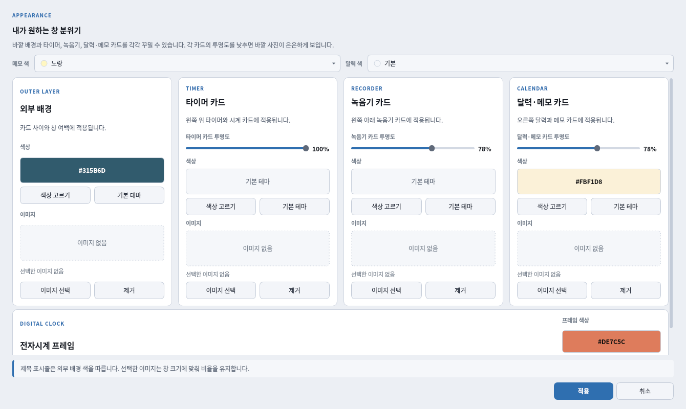

`설정 > 창 꾸미기...`에서는 다음 항목을 바꿉니다.

| 항목 | 적용 위치 |
|---|---|
| 메모 색 / 달력 색 | 할 일·문서 영역의 기본 메모 색, 달력의 기본 색 |
| 외부 배경 | 카드 사이와 창 바깥 여백의 색·이미지 |
| 타이머 카드 | 타이머 카드의 색·이미지·투명도 |
| 녹음기 카드 | 녹음 카드의 색·이미지·투명도 |
| 달력·메모 카드 | 플래너 카드의 색·이미지·투명도 |
| 전자시계 프레임 | 전자시계 테두리 색 |

변경 후 **적용**을 눌러 확정합니다. **취소**는 변경을 확정하지 않습니다.
기본 테마로 되돌리기와 배경 이미지 제거도 이 창에서 합니다.
고배율 화면에서는 창 안을 스크롤해 아래 항목을 확인하세요.
시스템과 앱의 테마가 달라도 이 창의 카드 사이 배경과 스크롤바는 선택한 앱 테마를 따릅니다.
카드의 불투명도는 **100%에 가까울수록 배경이 덜 비치며**, 값을 낮출수록 뒤의 이미지가 더 보입니다.

메모·달력의 **기본 배경색**과 개별 일정의 **표시 색상**은 다른 설정입니다.
일정 하나의 색을 바꾸려면 [일정 색상 선택](#calendar-details)을 사용하세요.

### 3.3. 달력 글씨 크기

`설정 > 달력 글씨 크기`에서 **90%, 95%, 100% (기본), 115%, 130%, 150%**를 고릅니다.
달력 셀의 날짜 숫자와 일정 글씨를 조절하며, 앱 전체 글꼴이나 창 크기를 바꾸는 설정은 아닙니다.
한 셀에 모든 글자를 표시할 수 없을 때는 할 일 목록이나 일정 요약에서 전체 내용을 확인하세요.
문서 본문 글자 크기는 문서 메모의 서식 도구에서 따로 바꿉니다.
이 비율은 Windows의 200%·250% 같은 **운영체제 화면 배율과 별개**입니다.

### 3.4. 알림·소리·마이크·언어

| 메뉴 | 설정 방법·주의점 |
|---|---|
| 설정 > 화면별 타이머... | 집중 타이머와 업무 흐름에 들어갈 때 사용할 집중·휴식·세트 기본값 지정 |
| 설정 > 일정 시간 알림 | 시간이 지정된 일정 알림 켜기·끄기 |
| 설정 > 알림 시점 | 정시에 / 5분 전 / 10분 전 / 15분 전 / 30분 전 선택 |
| 설정 > 알람 사운드... | 타이머 종료 소리 선택, 사용자 소리 파일 관리 |
| 설정 > 알람 소리 켜기 | 타이머 알람의 소리 켜기·끄기 |
| 녹음 > 마이크 설정 및 테스트... | 입력 장치를 고르고 말하면서 입력 레벨 확인 |
| 설정 > 녹음 저장 폴더... | 실제 녹음 파일을 저장할 PC의 폴더 지정 |
| 설정 > 언어 | 한국어 / English 선택 |
| 화면 > 항상 위에 표시 | 다른 창보다 위에 본창 유지 |

설정 메뉴에서 바꾼 앱 언어는 다음 실행부터 적용됩니다. 첫 실행의 시작 창에서는 먼저 언어를
고른 뒤 작업 화면을 선택하므로 바로 해당 언어로 시작할 수 있습니다. 사용자 일정·메모·문서의
내용을 자동 번역하는 기능은 아니며, 운영체제의 표시 언어도 변경하지 않습니다.

일정 알림은 TAKT가 실행 중일 때 동작합니다. 앱을 완전히 종료하거나 PC를 끄면 알리지 않습니다.
운영체제의 알림 허용·방해 금지 상태도 영향을 줍니다. 캘린더 화면의 표시 필터와 달리
알림은 전체 캘린더의 대상 일정을 확인합니다. 타이머 알람 소리와 일정 시간 알림은 서로 다른 설정입니다.

## 4. 집중 타이머 모드

**화면 구성:** 원형 뽀모도로 타이머, 집중·휴식·세트 조절, Start·Stop·건너뛰기 버튼입니다.
일정과 녹음 패널은 숨기고 타이머에 집중합니다.

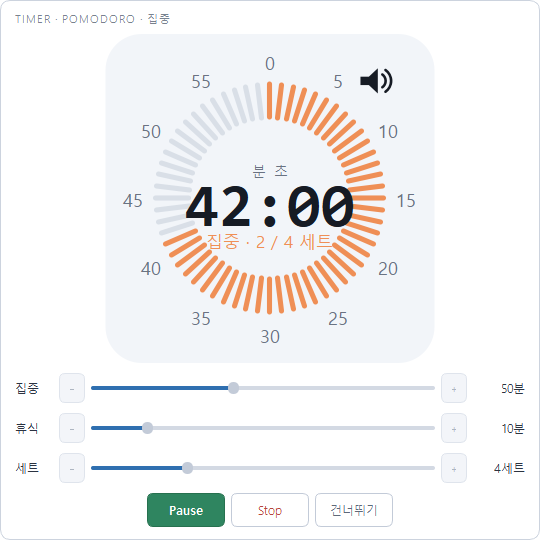

1. `현재 화면 > 집중 타이머`를 선택합니다.
2. 시작 전 집중 시간, 휴식 시간과 세트 수를 맞춥니다. 예: 집중 25분, 휴식 5분, 4세트.
3. **Start**를 눌러 시작합니다. 진행 중 같은 버튼으로 일시정지·재개할 수 있습니다.
4. **건너뛰기**로 다음 단계로 이동하거나 **Stop**으로 세션을 멈춥니다.
5. 다른 작업을 보면서 쓰려면 미니 위젯을 엽니다.

진행 중에는 시간 조절이 제한됩니다. 집중 시간을 바꾸려면 Stop 후 조절하세요.
이 모드는 뽀모도로 전용입니다. 카운트다운·스톱워치를 직접 고르려면 **모든 기능 보기**를 사용합니다.
다음에 모드에 들어갈 때의 기본값은 `설정 > 화면별 타이머...`에서 따로 맞출 수 있습니다.

## 5. 실전 말하기 연습 모드

**화면 구성:** 왼쪽 시간 표시와 녹음 조작, 오른쪽 유형·질문, 연습 조작, 주간 목표와 답변 목록입니다.
처음에는 유형 선택 화면이 나오며, 이후에는 마지막으로 고른 유형을 기억할 수 있습니다.

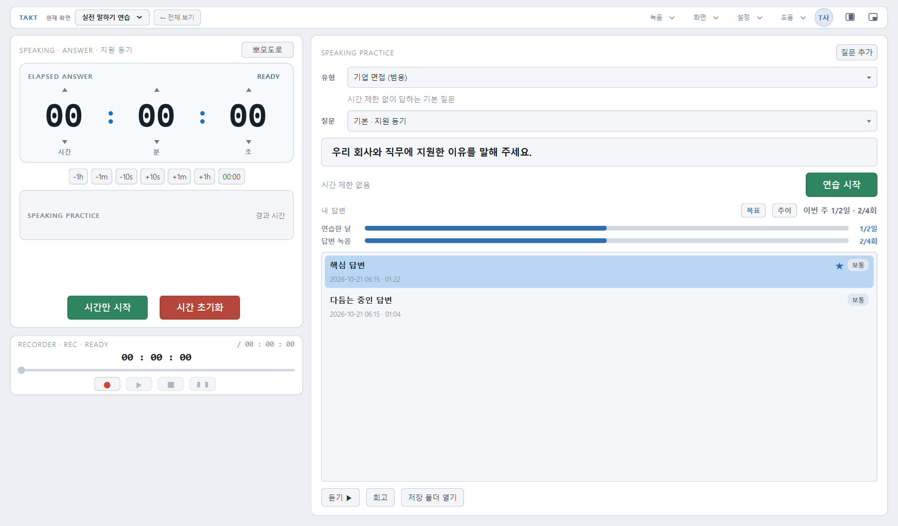

### 5.1. 유형과 질문 선택

| 기본 유형 | 용도 |
|---|---|
| 자유 연습 | 정해진 형식 없이 말하고 녹음 |
| 기업 면접 (범용) / 입시 면접 / 공직 면접 | 지원 동기·경험·상황 질문 연습 |
| 발음 · 낭독 | 발음과 읽기 연습 |
| 발표 · 즉흥 말하기 | 발표 구성·설명·즉흥 말하기 연습 |
| 영어 대화형 말하기 | 일상 주제에 답하는 연습 |
| 영어 과제형 말하기 | 읽기·묘사·응답·의견 등 과제별 연습 |

이 자료는 자체 연습용입니다. 공식 시험 문제, 점수 예측, AI 채점이나 음성 전사 기능은 제공하지 않습니다.

### 5.2. 한 번 연습하기

1. 유형과 질문을 고르고 질문 내용, 준비 시간, 답변 제한 시간을 확인합니다.
2. **연습 시작**을 누릅니다. 준비 시간이 있으면 먼저 준비 시간이 진행됩니다.
3. 준비가 끝나면 답변 녹음과 시간 측정이 함께 시작됩니다.
4. 제한 시간이 있는 답변은 카운트다운하며, 필요할 때 **+30초**로 연장합니다.
5. 일찍 마치려면 **답변 완료**를 누릅니다. 제한 시간이 없는 질문도 이 버튼으로 마칩니다.
6. 종료 후 저장 안내와 답변 목록을 확인하고 **듣기**로 다시 들어 봅니다.

말하기 연습의 답변은 완료·녹음 정지·제한 시간 종료 흐름에서 자동 저장됩니다.
**일반 녹음 카드에서 녹음한 것과는 저장 방식이 다릅니다.** 저장 실패 안내가 나오면 원인을 확인하세요.
녹음·재생·준비가 진행 중이면 다른 질문이나 모드로 전환하기 전에 정지해야 합니다.

### 5.3. 내 질문 만들기와 답변 관리

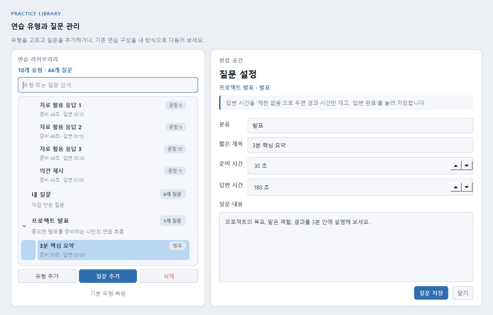

말하기 화면 오른쪽 위 **질문 추가**로 유형·질문 관리 창을 엽니다.
**유형 추가**, **질문 추가**로 내 연습을 만들고 제목, 질문, 준비·답변 시간을
정한 뒤 **저장**합니다. 제한이 필요 없으면 답변 시간을 **제한 없음**으로 둡니다.
기존 유형과 질문을 수정할 수 있으며, 기본 유형 복원은 확인 안내를 읽고 사용하세요.

답변을 선택해 **회고**에서 아쉬움·보통·좋음 평가와 메모를 남깁니다.
**추이**는 같은 질문의 녹음 길이와 회고를 비교하는 기능이며 자동 실력 평가가 아닙니다.
**목표**에서 주간 연습 목표를 설정하고 진행 상황을 확인합니다.
답변 목록을 우클릭하면 이름 변경·즐겨찾기·삭제를 사용할 수 있습니다.
기존 음성 파일을 답변 목록에 끌어다 놓으면 **현재 선택한 질문**의 기록으로 가져옵니다.

다른 PC에서 기록이 보이더라도 실제 소리 파일은 그 PC에 없을 수 있습니다.
파일을 옮길 때는 녹음 저장 폴더를 별도로 옮겨야 합니다.

## 6. 업무 흐름 모드

**화면 구성:** 왼쪽 위 집중 타이머, 왼쪽 아래 WORK LINKS, 오른쪽 달력과 메모입니다.
일반 녹음기는 이 모드의 기본 구성에 포함되지 않습니다.

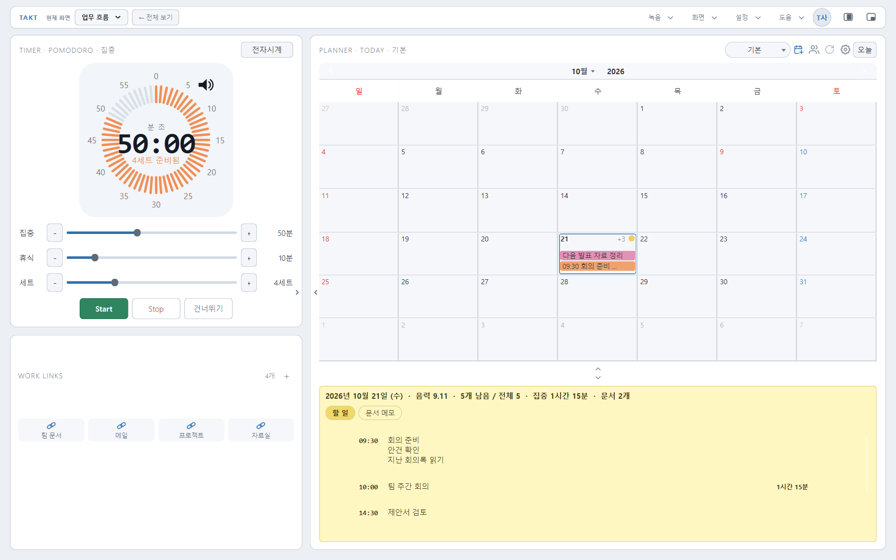

1. 시작 화면에서 **업무 흐름**을 누르거나 `현재 화면 > 업무 흐름`을 선택합니다.
2. 오른쪽에서 사용할 캘린더와 오늘 할 일을 확인합니다.
3. 할 일 행의 **집중 시작(삼각형)** 버튼으로 그 일에 대한 집중을 시작합니다.
4. 타이머를 진행하며 일하고, 마친 할 일을 완료 표시합니다.
5. 자주 쓰는 사이트는 WORK LINKS에 추가해 엽니다.

할 일에서 시작한 집중은 해당 항목에 집중 시간이 누적됩니다.
오늘 일정 정리 화면에서 집중 시작을 누르면 본창은 타이머와 할 일을 함께 보는 **업무 흐름**으로 전환됩니다.
다른 할 일의 집중 시작을 누르면 기존 연결을 끝내고 새 할 일로 집중을 시작하므로 대상을 확인하세요.
모드의 초기 시계는 뽀모도로이며, 타이머 대기 상태에서는 시계 표시를 바꿀 수 있습니다.
진행 중인 타이머가 있으면 Stop 후 바꾸세요.

WORK LINKS의 **+**에서 이름·주소를 입력해 링크를 추가합니다.
우클릭으로 주소 수정, 이름·아이콘 변경과 삭제를 합니다. 링크가 많으면 카드 내부를 스크롤합니다.
이 기능은 PC의 링크 목록이며, 브라우저의 즐겨찾기나 사이트 계정을 동기화하는 기능이 아닙니다.

## 7. 오늘 일정 정리 모드

**화면 구성:** 위쪽 달력, 아래쪽 할 일·문서 메모, 캘린더 선택과 공유·새로고침·오늘 버튼입니다.
타이머·녹음 카드 없이 일정과 기록을 넓게 봅니다.

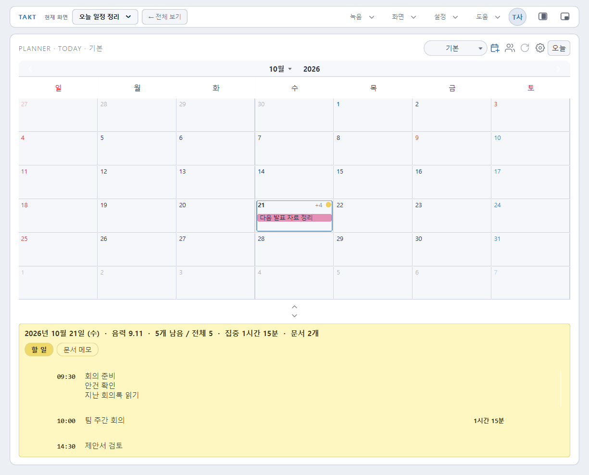

1. `현재 화면 > 오늘 일정 정리`를 선택합니다.
2. 달력 위 캘린더 목록에서 작성할 캘린더를 선택합니다.
3. 날짜를 한 번 눌러 선택하고 아래 **할 일**에서 입력하거나, 날짜를 더블클릭해 정식 일정 창을 엽니다.
4. 긴 글은 **문서 메모**로 전환해 작성합니다.
5. 오늘로 돌아오려면 달력 오른쪽 위 **오늘**을 누릅니다.

### 7.1. 캘린더 목록과 메인 캘린더

**종합 캘린더**는 여러 캘린더를 모아 보는 화면이고, 개별 캘린더는 그 캘린더의 내용만 보여 줍니다.
종합 화면의 할 일에는 소속 캘린더 이름이 표시됩니다.
빠른 입력과 지난 미완료 정리는 작성·처리할 **개별 캘린더**를 선택한 뒤 사용하세요.
종합 화면에서 정식 일정 추가 창을 열면 저장할 캘린더를 지정할 수 있습니다.

캘린더 목록을 펼쳐 원하는 항목을 **우클릭 > 이 캘린더를 메인 캘린더로** 지정하면
다음 실행에 먼저 표시할 캘린더가 됩니다. 종합 캘린더도 지정할 수 있습니다.
목록에서 **굵게 표시한 이름**이 다음 실행에 먼저 표시할 캘린더이며, 이름 뒤에 ‘메인’ 문구는 붙이지 않습니다.
체크 표시와 강조색은 **지금 보고 있는 캘린더**를 뜻하므로 굵게 표시한 항목과 다를 수 있습니다.
이는 앱의 시작 모드 선택이나 컴퓨터 자동 실행 설정과는 별개입니다.

목록 오른쪽 아이콘은 **달력 추가 → 공유(사용자) → 새로고침 → 관리(톱니바퀴)** 순서입니다.
달력 추가는 개인 용도의 캘린더를 만들고, 톱니바퀴는 선택한 캘린더를 관리합니다.
일~토 요일 행은 여유 있는 화면에서 이전 압축 높이의 1.5배입니다. 달력이 작아지면
날짜 행과 함께 높이·글씨가 줄어들어 요일만 과하게 커지지 않습니다.
읽기 전용·공유 여부와 내 권한에 따라 수정·삭제 메뉴가 달라집니다.
일반 개인 캘린더 삭제 시에는 내용을 다른 캘린더로 옮기는 안내를 확인하세요.
공유 캘린더의 전체 삭제와 나가기는 [공유 권한](#sync) 설명을 먼저 읽어 주세요.

### 7.2. 일정 요약과 문서 요약

달력 셀을 우클릭해 **일정 요약** 또는 **문서 요약**을 엽니다.
일정 요약에서는 지난 미완료와 앞으로의 일정을 확인하고 날짜를 찾아갈 수 있습니다.
선택한 캘린더의 범위를 기준으로 보며, 종합 캘린더에서는 전체 범위를 봅니다.
끝없는 반복은 무한히 나열하지 않고 앞으로 90일 범위로 계산합니다.
일정 요약은 **기본 최대 500건**을 표시합니다. 일회성 미래 일정은 90일 뒤라도 대상이지만,
항목이 많으면 이 상한 때문에 요약에서 빠질 수 있습니다. 전체 일정의 백업·내보내기 기능은 아닙니다.

긴 내용은 요약 카드 높이가 늘어나며, 일정이 많으면 창 내부를 스크롤합니다.
문서 요약은 날짜·문서 제목을 확인하고 태그로 필터링합니다. 문서를 선택하면 해당 날짜의 문서로 이동합니다.

### 7.3. 날짜 이동과 달력 표시 읽기

달력 위 좌·우 화살표로 이전·다음 달로 이동합니다. 월 이름을 누르면 월을 고를 수 있고,
연도를 선택해 다른 해로 이동할 수 있습니다. **오늘**은 오늘 날짜를 선택하며, **Ctrl+L**은
오늘 일정 정리 모드를 열고 오늘 입력칸으로 이동하는 조작입니다.

| 표시 | 의미 |
|---|---|
| 날짜 둘레의 테두리 | 현재 선택한 날짜 |
| 진한 날짜 숫자 | 오늘 또는 선택한 날짜 |
| 빨간 날짜 숫자 | 일요일·공휴일 또는 지난 미완료 할 일이 있는 날 |
| 파란 날짜 숫자 | 토요일; 지난 미완료 표시가 우선할 수 있음 |
| 옅은 붉은 배경 | 지난 미완료 할 일이 있는 날; 직접 지정한 날짜 색과 겹칠 수 있음 |
| 연하게 보이는 날짜·막대 | 현재 표시한 달의 앞뒤 날짜 |
| +숫자 | 해당 셀 안에 다 그리지 못한 일정 수; 날짜를 선택해 아래 목록에서 확인 |
| 날짜 옆 원형 색 점 | 그날 문서 메모의 대표 태그 색 |
| 제목의 취소선 | 완료 표시된 할 일 |

아주 낮은 셀에서는 일정 제목 대신 작은 색 점으로 줄여 보일 수 있습니다.
글자가 `…`로 끝나거나 막대에 제목이 없더라도 내용이 삭제된 것은 아닙니다.
날짜 색은 우클릭으로 직접 지정할 수도 있으므로, 배경색만으로 상태를 단정하지 마세요.

## 8. 모든 기능 보기와 일반 녹음

**화면 구성:** 타이머, 일반 녹음기, WORK LINKS, 달력과 메모를 한 화면에서 봅니다.
실전 말하기의 질문·답변 관리 화면은 `현재 화면 > 실전 말하기 연습`에서 엽니다.

### 8.1. 전자시계·카운트다운·스톱워치

`화면 > 시계 디자인`에서 Digital / Pomodoro를 고릅니다.
**모든 기능 보기**에서는 `화면 > 타이머 방식`으로 카운트다운과 스톱워치를 고를 수 있습니다.
시계 카드의 표시 전환 버튼으로도 디자인을 바꿀 수 있습니다.

카운트다운은 H·M·S 칸을 눌러 시간을 입력하고 Start로 시작합니다.
두 자리를 채우면 다음 칸으로 이동하며 Tab으로도 이동합니다.
스톱워치는 경과 시간을 재고 **Lap**으로 구간을 남깁니다.
Stop은 측정을 멈추고 설정 상태로 돌아가는 조작입니다.
입력 중인 값과 진행 상태를 확인한 뒤 시작하세요.

### 8.2. 일반 녹음 저장하기

1. `녹음 > 마이크 설정 및 테스트...`에서 실제 입력이 들어오는지 확인합니다.
2. 녹음 카드의 녹음 시작 버튼을 누릅니다.
3. 일시정지·재개 또는 정지 버튼으로 조작합니다. 녹음을 다시 누르는 것이 정지는 아닙니다.
4. 재생 버튼으로 내용을 듣고 필요하면 재생 위치 막대를 옮깁니다.
5. **녹음 > 녹음 저장...**에서 WAV / MP3와 저장 위치를 정합니다.

일반 녹음은 정지했다고 파일 저장이 끝나는 것이 아닙니다.
저장하지 않은 녹음을 닫거나 새 녹음으로 바꾸려 할 때의 안내를 확인하세요.
MP3 저장을 지원하지 않는 설치 환경이라는 안내가 나오면 WAV로 저장할 수 있습니다.
파일 열기는 일반 재생용이며, 특정 질문의 답변 목록에 넣으려면 말하기 연습의 파일 가져오기를 사용합니다.

## 9. 일정·할 일의 세부 기능

### 9.1. 날짜 셀과 할 일 행의 차이

| 조작 | 결과 |
|---|---|
| 달력 셀 한 번 클릭 | 날짜 선택, 아래 할 일·문서 표시 |
| 달력 셀 더블클릭 | 해당 날짜의 일정 추가 창 열기 |
| 달력 셀 우클릭 | 이 날짜 보기, 일정 추가, 일정 요약, 문서 요약, 날짜 색 |
| 할 일 내용 클릭 | 그 행의 내용을 바로 편집 |
| 할 일 행 우클릭 > 자세히 수정... | 시간·기간·상세 메모·색상·반복을 편집 |
| 완료 표시 | 끝낸 할 일 표시 |
| 행의 집중 시작 버튼 | 그 할 일에 대한 뽀모도로 집중 시작 |
| 행의 삭제 버튼 | 해당 항목 삭제, 반복이면 범위 확인 |

할 일의 **빈 줄 입력과 기존 내용 편집은 Enter 또는 다른 곳 클릭으로 확정**합니다.
별도의 저장 버튼을 찾을 필요는 없지만, 입력 도중에는 아직 저장소에 반영되지 않은 글자가 있을 수 있습니다.
특히 새로고침·기기 이동 전에는 먼저 입력을 확정하세요. 문서 본문은 이와 달리 잠깐 입력을 멈추면 자동 저장됩니다.
**Ctrl+S는 녹음 저장**이며, 할 일·문서를 저장하는 공통 단축키가 아닙니다.

빠른 입력 맨 앞에 `17:00 팀 회의`처럼 **시:분 + 공백 + 내용**을 쓰면 시작 시간으로 분리합니다.
`1700 팀 회의`처럼 콜론이 없는 표기는 시간 지정으로 해석하지 않습니다.
기존 시간을 없애거나 종료 시간·상세 메모를 넣으려면 **자세히 수정...**을 사용하세요.
일반 할 일 내용을 전부 지운 채 확정하면 그 항목이 삭제됩니다. 제목만 바꾸려던 경우 빈 상태로 확정하지 마세요.

집중 시작·삭제 버튼은 행에 마우스를 올리면 나타날 수 있습니다.
**할 일**은 체크하고 끝내는 항목입니다. **기록**은 조퇴·외근처럼 남겨 둘 내용으로,
할 일 완료 대상이나 지난 미완료 가져오기 대상이 아닙니다. 행의 우클릭 메뉴에서 종류를 바꿀 수 있습니다.

### 9.2. Enter와 Shift+Enter

할 일 내용 입력 중 **Enter**는 입력을 확정하고 목록 맨 아래의 새 입력 줄로 이동합니다.
**Shift+Enter**는 다음 항목을 만들지 않고 **같은 할 일 안에 줄바꿈**을 넣습니다.

예: `회의 준비` 입력 후 Shift+Enter, `안건 확인` 입력 후 Shift+Enter,
`지난 회의록 읽기`를 쓰면 세 줄이 하나의 할 일로 남습니다.

내용만 아래로 확장되고 완료 표시·시간·실행·삭제 조작은 첫 줄 쪽에 정렬됩니다.
내용이 많아지면 **할 일 목록 전체를 스크롤**합니다. 여러 줄 메모를 여러 개의 할 일로 오해하지 마세요.

### 9.3. 기간과 일정 색상

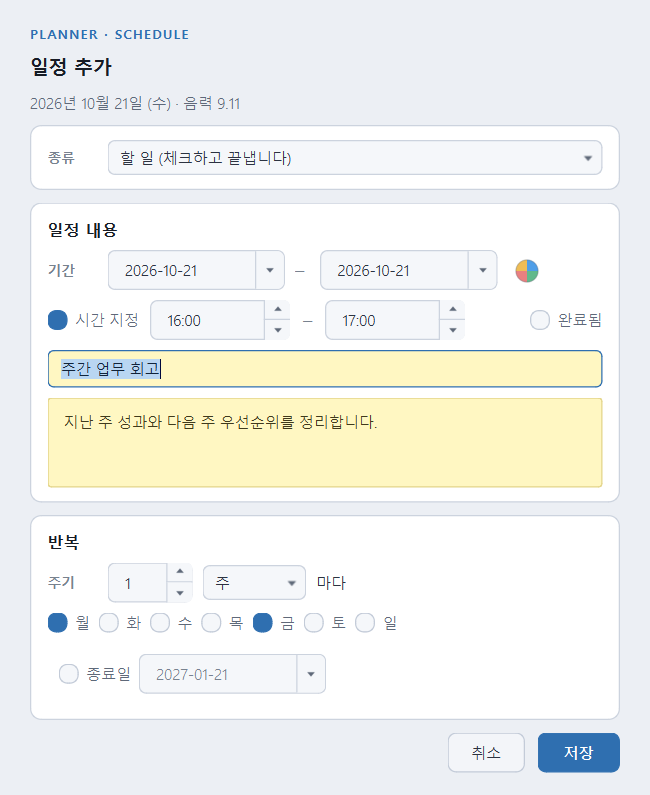

일정 추가 창에서 종류, 기간, 시간 지정, 제목, 메모와 반복을 설정하고 **저장**합니다.
기간의 시작일과 종료일을 같게 두면 하루 일정입니다.
예를 들어 **09일부터 11일까지** 입력하려면 같은 달의 09일을 시작일, 11일을 종료일로 고릅니다.
여러 날 일정은 날짜를 가로지르는 색상 막대로 표시되며 주·월 경계에서도 이어집니다.

**기간 오른쪽 원형 색상 버튼**을 눌러 팔레트를 열고 색을 고릅니다.
하루 할 일도 정식 입력·수정 창에서 색을 고를 수 있습니다.
아래 빠른 할 일 입력으로 만든 항목에는 자동 색상이 적용되므로, 이후 자세히 수정에서 바꾸세요.
날짜 셀의 배경색을 고르는 기능과는 다릅니다.

하나의 여러 날 일정은 매일 복사된 여러 일정이 아니라 같은 항목입니다.
시작일과 종료일은 모두 포함합니다. 09일~11일이면 09·10·11일의 3일입니다.
범위 안 다른 날짜에서 수정·삭제할 때도 같은 원본에 영향을 줍니다.
**여러 날 기간과 반복 설정을 동시에 사용할 수는 없습니다.**

### 9.4. 반복 일정의 수정과 삭제 범위

반복은 일·주·월 단위와 간격, 필요한 요일·종료일을 정합니다.
같은 주의 이어지는 반복은 선택한 색의 띠로 표시되며 연속 구간의 앞쪽에 제목이 표시됩니다.

반복에서 나온 항목을 **자세히 수정...**하면 내용·시간의 적용 범위를 **이 날짜만 / 반복 전체**로 고릅니다.
색상 버튼의 팔레트에도 별도의 **색상 적용 범위: 반복 전체 / 이 날짜만**이 있습니다.
**내용 수정 범위와 색상 수정 범위는 독립적**입니다. 저장 전에 양쪽을 확인하세요.
한 날짜만 다른 색으로 지정하면 그 날짜는 다른 색의 별도 구간처럼 보일 수 있습니다.

| 삭제 위치·메뉴 | 영향 |
|---|---|
| 반복의 첫 발생일에서 삭제 | 이후 반복과 수정된 회차를 포함한 반복 전체 삭제 확인 |
| 중간 날짜의 일 반복 삭제 | 그 날짜의 반복 삭제 |
| 중간 날짜의 주 반복 삭제 | 해당 주기의 주 반복 삭제 |
| 중간 날짜의 월 반복 삭제 | 해당 주기의 월 반복 삭제 |
| 이 날짜만 빼기 | 다른 반복을 유지하고 그 날짜만 제외 |
| 반복 전체 삭제 / 수정 창의 반복 삭제 | 반복 규칙 전체 삭제 확인 |

삭제 확인창의 범위를 읽고 결정하세요. 일부 기간을 지우려다 전체를 지우지 않도록,
반복의 **첫 발생일**에서 삭제할 때 특히 주의해야 합니다.

### 9.5. 지난 미완료 정리

개별 캘린더에서 처리할 날짜를 선택하고 **지난 미완료 ...개 정리**를 누릅니다.
대상 항목을 선택한 뒤 **가져오기** 또는 **완료 처리**를 고릅니다.

가져오기는 선택 날짜로 **이동**하는 기능입니다. 오늘을 선택했다면 오늘로 옮겨집니다.
완료 처리는 날짜를 옮기지 않고 원래 날짜의 항목을 완료로 바꿉니다.
반복 일정·기록형 일정·읽기 전용 캘린더는 이 일괄 정리 대상에서 제외됩니다.
정리 창에서 Enter는 실수로 일괄 처리를 확정하지 않도록 취소 동작이 기본입니다.

## 10. 문서 메모와 태그

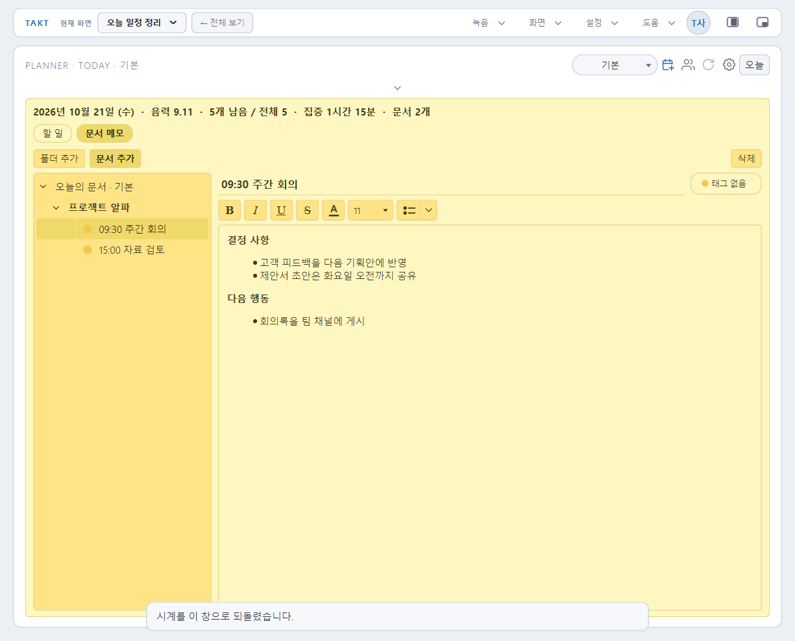

1. 날짜와 캘린더를 선택하고 **문서 메모**로 전환합니다.
2. **폴더 추가 / 문서 추가**로 정리할 구조를 만듭니다.
3. 문서를 선택해 제목과 본문을 입력합니다. 선택한 폴더가 있으면 그 아래에 추가합니다.
4. 굵게·기울임·밑줄, 글자 크기·색, 글머리·번호 목록으로 정리합니다.
5. 문서 제목 옆 태그 버튼에서 태그를 붙이거나 **태그 만들기... / 태그 관리...**를 사용합니다.

내용은 자동으로 저장됩니다. 저장 실패 안내가 나오면 재시도하고 원본을 보존하세요.
폴더와 문서는 **선택한 날짜·캘린더에 속합니다**. 다른 날짜에서 보이지 않으면 문서 요약으로 찾아보세요.
폴더 삭제는 하위 문서에도 영향을 줄 수 있으므로 확인창의 대상을 읽어 주세요.
태그 삭제는 문서 삭제가 아니며, 문서 내용은 남습니다.

태그에는 이름과 색을 지정합니다. 한 날짜에 여러 문서·태그가 있더라도 달력에는
그날 가장 많이 쓰인 **대표 태그의 원형 점 하나**로 표시됩니다.
태그 없는 문서는 **미분류**로 표시되고, 문서 요약에서 태그별로 찾을 수 있습니다.
공유 문서에는 마지막 편집자 정보가 표시됩니다. 작성자를 알 수 없는 옛 항목은 표시가 없을 수 있습니다.

### 10.1. 서식 버튼 사용하기

본문에서 바꿀 글자를 먼저 드래그해 선택한 뒤 서식을 누릅니다. 선택하지 않으면 현재 커서에서
입력할 글자의 서식으로 적용될 수 있습니다. **B / I / U / S**는 굵게·기울임·밑줄·취소선이며,
본문에 포커스가 있을 때 **Ctrl+B / Ctrl+I / Ctrl+U**로도 조작합니다.

목록 도구는 두 부분입니다. 왼쪽 아이콘은 마지막으로 고른 목록을 적용하고,
오른쪽 작은 화살표는 **목록 스타일** 창을 엽니다. 검정·빈 동그라미, 네모, 숫자, 영문자 목록을 고르거나
**목록 없애기**로 일반 문단으로 되돌립니다. 문서 자체를 삭제하는 조작은 아닙니다.
좁은 창에서 글자 크기 선택칸이 숨겨지면 메모를 크게 펼치거나 창 폭을 넓혀 사용하세요.

## 11. 계정·자동 동기화·공유 캘린더

### 11.1. 로그인과 첫 연결

프로필 버튼 또는 `설정 > 내 정보...`를 엽니다.
프로필 편집에서 닉네임과 사진을 바꿀 수 있고, 연결된 계정의 이메일과 상태를 확인할 수 있습니다.
로그아웃 상태에서는 **계정 연결**이 로그인 진입 버튼이고, 로그인 후 **로그아웃**이 표시됩니다.
로그인 첫 화면에는 **아이디 또는 이메일 / 비밀번호** 입력란, **로그인**, **비밀번호 찾기 / 아이디 찾기 / 회원가입**,
**구글로 계속하기 / 카카오로 계속하기**가 표시됩니다. 기존 이메일 계정은 아이디를 추가하지 않아도 이메일로 로그인합니다.
신규 이메일 가입은 영문자로 시작하는 4~20자의 영문·숫자·밑줄 아이디를 중복 확인한 뒤
닉네임·이메일·비밀번호와 비밀번호 확인을 같은 창에서 입력합니다. 아이디를 수정하면 중복 확인을 다시 해야 합니다.
새 계정을 만들면 받은 인증 메일에서 인증을 완료하고 로그인하세요.
인증 메일은 도착까지 몇 분 걸릴 수 있습니다. 보이지 않으면 받은편지함·스팸함과 입력한 이메일을
확인한 뒤 **인증 메일 다시 받기**를 누르세요.
주소를 잘못 적었다면 **메일 주소 다시 입력**으로 가입 입력 화면에 돌아가 수정할 수 있습니다.
비밀번호는 다시 입력하고 아이디 중복 확인도 새로 해야 합니다. 이전 미인증 요청의 아이디는
최대 하루 동안 예약될 수 있으니, 기존 메일을 확인하거나 다른 아이디를 선택해 주세요.
이미 사용 중인 TAKT 계정이라면 다시 가입하지 말고 해당 계정으로 로그인하세요.
이메일 가입 외에 **구글로 계속하기 / 카카오로 계속하기**로 처음 로그인하면 새 TAKT 계정으로 시작할 수 있습니다.
기본 브라우저에서 계정 선택과 동의를 마친 뒤 TAKT 창으로 돌아오세요. 인증 중에는 앱을 종료하지 마세요.
브라우저에 **이어서 TAKT에서 확인해 주세요** 안내가 나오면 `Alt+Tab`이나 작업 표시줄로 TAKT를 선택합니다.
브라우저 인증 응답 수신과 앱의 최종 로그인·연결 성공은 다릅니다. TAKT의 계정 이메일과 연결 상태까지 확인합니다.
취소·오류 안내가 나오면 앱에서 안내를 확인하고 다시 시도하세요. 기존 일정이나 메모를 삭제할 필요는 없습니다.

이미 TAKT를 사용했다면 먼저 **기존 TAKT 계정으로 로그인**한 뒤 내 정보의 **기기 동기화** 박스에서
로그아웃 옆 **간편 로그인 연결**을 누르세요. 원하는 Google·카카오 계정을 연결하면 기존 일정과 공유 참여를
유지하면서 그 서비스로도 로그인할 수 있습니다. 다른 TAKT 계정에 이미 연결된 로그인 수단은 연결할 수 없습니다.
연결 대신 별도로 신규 가입하면 기존 계정과 다른 계정이 될 수 있으므로, 기존 자료를 합치려는 방법으로 사용하지 마세요.
캘린더 초대에 사용할 이메일은 Google·카카오 메일이라고 추측하지 말고 **TAKT 내 정보에 표시된 계정 이메일**을 확인하세요.
**이 컴퓨터에서 로그인 유지**는 다음 실행에도 계정을 연결할지 고르는 옵션입니다.
함께 쓰는 PC에서는 선택 여부를 신중히 정하고 사용 후 로그아웃하세요.

**로그인 정보를 잊었을 때**

로그인 첫 화면의 **아이디 찾기**에 가입 이메일을 입력하고 메일 인증을 마치면 아이디를 확인할 수 있습니다.
아이디를 추가하지 않은 기존 계정은 인증 후 이메일 로그인 안내가 표시됩니다.
비밀번호는 **비밀번호 찾기**에 아이디 또는 이메일을 입력해 등록 이메일의 재설정 링크로 변경합니다.
가입 당시 사용한 Google·카카오 비밀번호는 해당 서비스에서 재설정합니다.
이름만으로 이메일을 조회하거나, 입력한 주소의 가입 여부를 화면에서 확인하는 기능은 제공하지 않습니다.

이메일 비밀번호를 잊었다면 다음 순서로 **새 비밀번호를 설정**합니다.

1. **비밀번호 찾기**에 아이디 또는 가입 이메일을 입력하고 **재설정 메일 받기**를 누릅니다.
2. **이 창과 TAKT를 열어 둔 채**, 요청한 PC에서 15분 안에 메일의 링크를 엽니다. 스팸함도 확인하세요.
3. TAKT 창으로 돌아와 **새 비밀번호**와 **비밀번호 다시 입력**에 8자 이상으로 입력하고 **비밀번호 변경**을 누릅니다.
4. 완료 안내를 확인한 뒤 **로그인으로**를 눌러 기존 이메일과 새 비밀번호로 로그인합니다.

화면에는 가입 여부와 관계없이 같은 안내를 표시합니다. 메일 재요청은 60초 후 가능하며,
새 요청을 하면 이전 요청의 앱 연결은 닫힙니다. 창을 닫거나 시간이 지나면 다시 요청하세요.
재설정 인증은 일반 로그인·자동 동기화와 분리되어 있습니다. 기존 계정·캘린더·공유 권한은 그대로 유지되며,
이 과정으로 새 계정을 만들거나 자료를 다른 계정으로 옮기지 않습니다.
로그인 후 **내 정보 > 계정 설정**에서 이메일·아이디·비밀번호를 한 창에서 확인합니다.
이메일은 확인용 읽기 전용이며, 기존 계정의 아이디 추가는 선택 사항입니다.
비밀번호가 있는 계정은 현재 비밀번호를 확인해 변경하고, 간편가입 계정은 이메일 인증으로 비밀번호를 설정할 수 있습니다.

안전하게 판단할 수 있으면 처음 연결할 때도 자동으로 동기화합니다.
새 기기의 빈 자료는 계정에서 가져오고, 처음 연결하는 빈 계정에는 이 PC 자료를 올립니다.
내용이 같거나 한쪽만 바뀐 경우에는 따로 묻지 않습니다. 마지막 동기화 자료와 비교해
서로 다른 일정·항목·필드의 변경도 충돌 없이 합칠 수 있으면 자동 처리합니다.

같은 항목의 서로 다른 수정, 삭제와 수정의 겹침, 원인을 알 수 없는 전체 초기화,
다른 계정의 자료, 또는 비교 기준을 확인할 수 없는 경우에만 **동기화 자료 확인**이 필요합니다.
이때 양쪽 자료는 보존하며 확인이 필요한 자료 종류에만 선택을 적용합니다.

| 선택 | 의미 |
|---|---|
| 이 PC 데이터를 계정에 합치기 | 기존 서버 자료를 유지하면서 이 PC의 자료를 합치기 |
| 계정 데이터로 이 PC 시작 | 이미 계정에 있는 자료를 이 PC에 가져와 시작 |

이 PC에만 남은 중요한 작업이 있다면 먼저 백업하고 합치기를 검토하세요.
동일한 ID의 내용이 충돌하면 계정 원본을 유지하고 로컬 내용을 `(이 PC)` 사본으로 보존할 수 있습니다.
어느 한 PC가 무조건 다른 PC를 덮어쓰는 방식이라고 생각하면 안 됩니다.

### 11.2. 자동 동기화와 전체 새로고침

작성한 내용은 먼저 **이 PC에 저장**됩니다. 로그인·인터넷 연결 상태에서는 변경 사항을 자동으로
서버에 반영하고 다른 기기의 변경을 가져옵니다. 매번 프로필의 **지금 동기화**를 누를 필요는 없습니다.
다만 모든 입력이 즉시 서버에 도착한다는 뜻은 아닙니다.
할 일 입력을 Enter 또는 다른 곳 클릭으로 먼저 확정한 뒤 동기화 상태를 확인하세요.

오프라인에서는 로컬 변경을 보존하고 연결이 복구되면 다시 동기화합니다.
다른 PC로 이동하거나 종료하기 직전의 중요한 변경은 내 정보에서 **동기화됨**을 확인하세요.
업로드가 끝나기 전에 강제로 종료하거나 바로 전원을 끄면 다른 PC에는 아직 안 보일 수 있습니다.

팀원이 공유 일정을 방금 추가했다면 달력의 **공유(사용자)와 관리(톱니바퀴) 사이 새로고침 아이콘**을 누릅니다.
계정에 연결된 개인 자료·공유 캘린더·초대 정보를 다시 확인하는 전체 새로고침입니다.
웹 ICS 구독은 구독 창의 **현재 구독 새로고침**을 별도로 사용합니다.

| 자료 | 같은 계정의 다른 PC에 반영 |
|---|---|
| 개인 일정·반복·문서·폴더·태그 | 계정 동기화 대상 |
| 말하기 연습 유형·질문·기록·회고 | 계정 동기화 대상 |
| 공유 캘린더 내용 | 해당 캘린더에 참여한 계정들이 서버에서 확인 |
| 실제 녹음 파일 | 자동 동기화하지 않음; 녹음한 PC에 보관 |
| 창 위치·테마·마이크·작업 링크 등 PC별 설정 | PC마다 별도 설정 |

로그아웃은 계정이나 서버 자료를 삭제하는 기능이 아닙니다.
공유 캘린더는 로그인 세션에 연결되므로 로그아웃 후 목록에서 안 보여도 전체 삭제된 것은 아닙니다.
Ubuntu에서 로그인 유지가 비활성화되면 키링 상태 안내를 확인하세요.
현재 실행의 로그인·동기화와, 재실행 후 로그인 유지 가능 여부는 구분해야 합니다.

### 11.3. 개인 캘린더와 공유 캘린더

**같은 내 계정으로 기기를 바꾸는 것**과 **다른 사람과 캘린더를 공유하는 것**은 다른 기능입니다.
개인 캘린더는 공유로 바꾸지 않아도 같은 계정으로 로그인한 PC 간에 동기화됩니다.

달력의 **공유(사용자) 아이콘**을 누르고 **초대하기·받기** 영역의 캘린더 목록에서 대상을 선택합니다.
이미 작성한 캘린더는 일정·반복·문서·폴더·태그와 함께
공유 상태로 전환합니다. 기본 캘린더도 별도의 빈 공유 복사본을 만드는 것이 아니라 같은 캘린더를 전환합니다.
목록에서 대상을 고른 뒤 **초대하기**로 다음 단계에 들어갑니다. 목록 선택만으로 전환되는 것은 아닙니다.
새 용도라면 목록을 펼쳐 맨 아래 **+ 새 캘린더 생성**을 선택합니다. 별도의 기존 캘린더·캘린더 생성 버튼은 없습니다.
공유 전환은 독립된 개인 백업 사본을 하나 더 만들어 주는 기능은 아닙니다.

처음 팀원과 공유할 때는 **내 계정 연결 → 공유 창의 목록에서 캘린더 선택 → 초대하기 →
상대의 TAKT 계정 이메일로 전송 → 상대가 초대함에서 수락** 순서로 진행합니다.
같은 내 계정의 PC끼리 쓰는 것이라면 이 초대 절차는 필요하지 않습니다.

### 11.4. 초대와 초대함

내 정보의 **공유 캘린더** 또는 달력의 공유 아이콘에서 **초대하기**를 선택합니다.
대상 캘린더를 확인하고 상대방의 **TAKT 계정 이메일**과 권한을 지정한 뒤 **초대 보내기**를 클릭합니다.
이메일 입력칸에서 **Enter는 다음 이메일 칸으로 이동**하는 조작이며, 초대 전송이 아닙니다.

**초대함**에는 받은 초대와 보낸 초대 이력이 있으며, 상태 필터로 찾을 수 있습니다.
받은 초대에서 발신자·메일·캘린더를 확인하고 수락 또는 거절합니다.
보낸 초대에서는 대기·수락·거절 등의 상태와 앱 내 확인·응답 시각을 확인합니다.
확인 시각은 **TAKT 앱 안에서 초대를 확인한 시각**이며 외부 이메일 읽음 추적이 아닙니다.
관리 가능한 대기 초대는 취소할 수 있습니다.

### 11.5. 사용자 목록과 권한

달력 위 캘린더 목록을 펼쳐 공유 캘린더를 **우클릭 > 공유 사용자 목록**으로 엽니다.
각 캘린더별 **이름(메일)과 권한**을 확인할 수 있습니다.
권한 콤보박스는 소유자·공동 소유자가 변경할 수 있으며 확인창을 거쳐 서버 반영 후 적용됩니다.
본인이나 주 소유자 등 변경할 수 없는 항목은 비활성화될 수 있습니다.
내보낼 수 있는 사용자의 오른쪽 **×** 버튼을 누르면 확인 후 그 캘린더의 참여를 해제합니다.
이는 TAKT 계정 자체를 삭제하는 기능이 아닙니다. 대상 이름과 캘린더를 확인하고 진행하세요.
목록 아래 **+ 사용자 추가**를 누르면 이메일로 초대하는 입력 영역이 펼쳐집니다.
현재 캘린더를 유지한 채 이메일과 권한을 지정하고 초대를 보낼 수 있습니다.

| 권한 | 일정·할 일·문서 편집 | 관리 범위 |
|---|---|---|
| 읽기 권한 | 불가 | 내용 조회 |
| 수정 권한 | 가능 | 내용 작성·수정·완료·삭제 |
| 관리자 권한 | 가능 | 읽기·수정 사용자 초대와 관리; 다른 관리 권한은 제한 |
| 소유자 / 공동 소유자 | 가능 | 사용자 권한 변경, 소유권 양도, 캘린더 전체 삭제를 포함한 전체 권한 |

**관리자에게 사용자 권한 변경·소유권 양도·전체 삭제 권한까지 주는 것은 아닙니다.**
서버가 최종 권한을 검사하므로 권한이 바뀌었거나 동기화 중이면 일부 조작이 제한될 수 있습니다.
공유 일정·할 일의 작성자와 문서의 최종 편집자 표시로 누가 입력했는지도 확인할 수 있습니다.

### 11.6. 소유권 양도·나가기·전체 삭제

소유권 관리는 내 정보의 **공유 캘린더 > 초대하기**에서 대상 캘린더의 관리 창을 열어 진행합니다.
소유자는 구성원을 선택해 **선택한 구성원에게 소유권 양도**를 누르고 확인합니다.
관리 창 위쪽의 캘린더 목록으로 대상을 바꿀 수 있으므로, 양도·내보내기·삭제 전에 제목과 선택 대상을 확인하세요.
목록 우클릭의 **공유 사용자 목록**은 사용자·권한 확인용이며, 양도·전체 삭제는 위 관리 창에서 합니다.

양도 후 새 소유자가 주 소유자가 되며, **이전 소유자는 공동 소유자로 전체 권한을 유지**합니다.
이는 권한 변경·재양도·전체 삭제 권한도 포함합니다. 양도만 했다고 이전 소유자의 접근이 사라지지 않습니다.
이전 소유자가 참여를 끝내려면 **캘린더에서 나가기**를 사용합니다. 그 경우 캘린더와 다른 구성원은 유지됩니다.

**캘린더에서 나가기**는 내 참여를 끝내는 것이고, **캘린더 삭제**는 모든 구성원의 캘린더와 내용을
삭제하는 것입니다. 퇴사·담당자 변경 시에는 양도 후 나가기를 검토하고, 전체 삭제와 혼동하지 마세요.

### 11.7. ICS 파일과 웹 일정 주소

공유 아이콘의 **가져오기·내보내기**에서 ICS 파일을 새 캘린더로 가져오거나 선택 캘린더를 내보냅니다.
웹 주소는 **웹 주소 구독 보기 > 읽기 전용으로 추가**로 구독합니다.
구독 일정은 원본 서비스에서 수정하고 TAKT에서 다시 읽어 옵니다. 가져온 일정과 읽기 전용 구독은 다릅니다.
가져오기 결과에 지원하지 않는 반복 규칙 안내가 있으면 그 규칙이 전부 재현됐다고 가정하지 마세요.
ICS는 일정 교환용으로, TAKT 문서·계정·초대·권한까지 통째로 복원하는 백업 형식이 아닙니다.
파일 가져오기는 **한 번 가져온 편집 가능한 사본**, 주소 구독은 **원본을 수정하지 않는 읽기 전용 표시**입니다.
웹 구독 주소는 공개 ICS 주소여야 하며, 웹페이지의 일반 주소나 로그인 화면 주소와는 다릅니다.

## 12. 위젯 사용법

TAKT의 위젯은 앱 자체의 별도 창입니다. Windows 위젯 보드에 등록하는 기능은 아닙니다.
독립된 녹음·작업 링크 위젯이 각각 있는 것은 아니며, 필요한 경우 본창 위젯 모드를 사용합니다.

| 종류 | 열기 | 주요 용도 | 돌아오기 |
|---|---|---|---|
| 미니 타이머 위젯 | 화면 > 미니 위젯 열기 / Ctrl+M | 전자시계·뽀모도로를 작은 창으로 사용 | 전체 창 복귀 버튼 또는 더블클릭 |
| 달력 위젯 | 화면 > 달력 위젯 열기 / Ctrl+K | 달력·할 일·문서를 별도로 표시 | 위젯 닫기; 본창은 별도 유지 |
| 본창 위젯 모드 | 화면 > 위젯 모드 / Ctrl+Shift+W | 현재 작업 화면 전체를 위젯처럼 사용 | 창 복귀 버튼 또는 같은 단축키 |

### 12.1. 미니 타이머

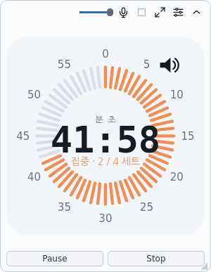

Start·Stop과 단계 전환을 작은 창에서 조작합니다. 뽀모도로에서는 설정 버튼으로
집중·휴식·세트를 바꾸고, 전자시계에서는 현재 타이머 방식의 조작을 사용합니다.
미니 위젯은 본창과 **같은 타이머**를 보여 주며 별도의 두 번째 타이머가 아닙니다.
본창 타이머에 **위젯으로 보는 중**이 표시되면 위젯에서 계속 사용할 수 있습니다.

상단의 빈 부분을 끌어 이동하고 투명도 슬라이더로 존재감을 조절합니다.
뽀모도로는 테두리·크기 조절 손잡이를 이용해 크기를 조절하며, 한 줄로 접을 수도 있습니다.
마이크·정지·창 복귀·설정·접기 조작은 배경 없는 아이콘으로 표시됩니다.
아이콘 위에 마우스를 두면 기능 설명을 확인할 수 있습니다.
녹음 시작·정지 버튼도 있지만 녹음 저장 방식은 [일반 녹음](#all)의 설명을 따라야 합니다.

### 12.2. 달력 위젯

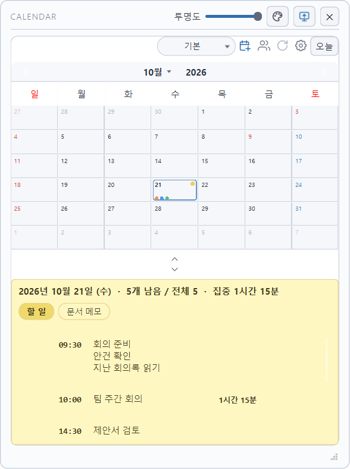

달력 위젯과 본창은 같은 저장소를 사용합니다. 서로 다른 일정 사본이 아닙니다.
상단 손잡이로 이동, 테두리로 크기 조절, 투명도 슬라이더로 농도 조절을 합니다.
**팔레트 아이콘**의 색 메뉴에서 달력·메모 색과 테마를 바꿉니다.
**모니터 아이콘**으로 다른 창 위에 둘지, 바탕화면 쪽에 둘지 전환합니다.
눌림 상태와 도움말로 현재 배치를 확인할 수 있습니다.
위젯 할 일의 집중 시작 버튼은 본창을 끌어내는 대신 미니 뽀모도로를 통해 집중할 수 있게 합니다.

### 12.3. 본창 위젯 모드와 종료

본창 위젯 모드에서는 타이머·달력·메모 등 현재 화면을 그대로 사용하면서 제목 표시줄·외곽 표시를
줄입니다. 상단 빈 부분을 끌어 이동하고 테두리로 크기를 조절합니다.
상단의 투명도 슬라이더·모니터 아이콘·창 복귀 아이콘을 사용하세요.
아이콘 위에 마우스를 두면 현재 배치와 기능 설명을 확인할 수 있습니다.
좁아지면 메뉴가 더보기에 묶입니다.
패널 화살표로 필요한 영역만 남길 수 있으며, 크기·위치는 일반 창과 구분해 기억합니다.

본창을 닫아도 위젯이 남아 있으면 앱이 계속 실행 중일 수 있습니다.
앱 전체를 끝내려면 `녹음 > 앱 종료` 또는 **Ctrl+Q**를 사용합니다.
크기 조절 중에도 달력과 글자는 새 크기에 맞춰 계속 배치됩니다. 배경 이미지는 드래그가
끝나면 원본에서 다시 그려집니다. 기기 성능에 따라 드래그 반응은 달라질 수 있습니다.

본창 하단에는 녹음·사운드 상태줄이 상시 표시되지 않습니다. 녹음 카드의 상태 도움말과
설정 메뉴의 사운드 도움말을 확인하세요. 일반 안내는 메인 창 위에 잠시 나타나고 사라집니다.
저장 실패는 해결 전까지 안내와 **다시 저장** 버튼이 유지됩니다. 알림이 떠도 창 크기나
달력·메모 배치는 바뀌지 않으며, 좌우·하단 바깥 여백에는 앱에 설정한 배경이 보입니다.

트레이 메뉴로 본창을 다시 열 수 있으며, 트레이가 없는 환경에서는 달력 위젯의 색 메뉴에
본창 열기·종료 항목이 제공됩니다.

Ubuntu Wayland에서는 창 자동 위치 지정과 다른 창과의 쌓임 순서가 제한될 수 있습니다.
수동으로 위치를 맞추거나 필요한 경우 Xorg 세션을 고려하세요. Windows와 위치 동작이 항상 같다고
보장하는 기능은 아닙니다.

## 13. 단축키와 입력 규칙

### 13.1. 자주 쓰는 단축키

| 키 | 동작 |
|---|---|
| Space | 타이머 시작 / 일시정지·재개 |
| Esc | 타이머 정지·설정 상태 복귀; 대화상자에서는 취소·닫기 |
| Ctrl+D | 가능한 대기 상태에서 시계 표시 전환 |
| Ctrl+N | 새 녹음 |
| Ctrl+O | 녹음 파일 열기 |
| Ctrl+S | 녹음 파일 저장; 모든 메모를 수동 저장하는 단축키는 아님 |
| Ctrl+R | 녹음 시작; 말하기 모드에서는 선택 질문 연습 시작 |
| Ctrl+P | 녹음 듣기 |
| Ctrl+L | 오늘 일정 열기 |
| Ctrl+K | 달력 위젯 열기 |
| Ctrl+M | 미니 위젯 전환 |
| Ctrl+Shift+W | 본창 위젯 모드 전환 |
| Ctrl+T | 항상 위에 표시 전환 |
| Ctrl+Shift+S | 타이머 알람 소리 켜기·끄기 |
| Ctrl+Q | 앱 전체 종료 |
| F1 | 단축키 안내 열기 |

글 입력창·메뉴·대화상자가 포커스를 가진 경우 그 창의 입력 규칙이 우선합니다.
예를 들어 본문에 공백을 쓰는 Space와 타이머를 시작하는 Space는 상황이 다릅니다.

### 13.2. 위치별 Enter·방향키

| 위치 | 키 | 결과 |
|---|---|---|
| 할 일 내용 | Enter | 확정 후 맨 아래 새 입력 줄 |
| 할 일 내용 | Shift+Enter | 같은 항목 안 줄바꿈 |
| 문서 본문 | Enter | 문서 안 다음 문단 |
| 초대 이메일 | Enter | 다음 이메일 입력칸; 전송하지 않음 |
| 타이머 H·M·S | Tab / Enter | 다음 칸 / 입력 확정 |
| 타이머 자리 선택 | 위·아래 방향키 | 선택한 시간 자리 증감 |
| 달력에 포커스 | 좌·우 / 위·아래 방향키 | 하루 / 한 주 단위 날짜 이동 |
| 지난 미완료 정리 | Enter | 안전을 위해 기본 취소 |

일반 저장·확인창에서는 기본 버튼이 Enter로 실행될 수 있습니다.
첫 동기화와 일괄 정리처럼 보호가 필요한 창의 기본값은 다를 수 있으니 선택 상태를 확인하세요.

## 14. 백업·업데이트·문제 해결

### 14.1. 동기화와 백업은 다릅니다

동기화는 기기 간 최신 상태를 맞추는 기능입니다. 실수로 삭제한 내용도 반영될 수 있어 과거 사본을
항상 보장하는 백업이 아닙니다. 중요한 수정 전에는 `설정 > 백업 > 백업 내보내기...`로 ZIP을 만드세요.

| ZIP에 포함 | 별도로 보관해야 하는 것 |
|---|---|
| 개인 일정·문서 등의 planner.json, 말하기 연습 기록 interview.json | 실제 녹음 파일, 앱 설정·배경 이미지, 서버 공유 캘린더의 전체 복구 자료 |

**실제 녹음 파일은 ZIP에 들어가지 않습니다.** 녹음 저장 폴더를 별도로 보관하세요.
공유 캘린더는 개인 planner.json과 별도로 관리되므로, 개인 ZIP만으로 공유 데이터·구성원·권한까지
복원할 수 있다고 생각하면 안 됩니다. 일정 사본이 필요하면 별도 ICS 내보내기도 사용할 수 있습니다.

복원은 `설정 > 백업 > 백업 가져오기...`에서 백업 날짜와 포함 항목, 현재 자료 변경 안내를 확인한 뒤
진행합니다. 서로 다른 두 작업본을 합치는 기능으로 사용하지 마세요.
앱은 시작 시 하루 한 번 최근 데이터 사본을 만들며, `자동 사본 폴더 열기`에서 확인합니다.
데이터 파일별로 최근 **7개 날짜의 자동 사본**을 유지합니다. 복원 전 현재 파일은 같은 폴더에
`.before-restore` 사본으로 남지만, 이 보호 사본만 믿고 중요한 원본 백업을 생략하지 마세요.
자동 사본은 녹음 파일을 포함한 전체 PC 백업을 대신하지 않습니다.

### 14.2. 자료 위치와 업데이트

| 자료 | 기본 위치 |
|---|---|
| Windows 일정·문서·연습 기록 | Windows의 내 문서 아래 TAKT 폴더 |
| Ubuntu 일정·문서·연습 기록 | 문서 폴더 아래 TAKT, 일반적으로 ~/Documents/TAKT |
| 실제 녹음 | 설정 > 녹음 저장 폴더...에서 지정한 위치 |
| Ubuntu 앱 설정 | 일반적으로 ~/.config/TAKT/TAKT.conf |
| Ubuntu 자동 시작 | 일반적으로 ~/.config/autostart/TAKT.desktop |

문서 폴더의 실제 위치는 운영체제 언어·OneDrive·사용자 설정에 따라 다를 수 있습니다.
Windows 스토어판의 설정은 앱이 관리하므로 레지스트리나 데이터 폴더를 임의로 지우지 마세요.
Windows는 Microsoft Store, Ubuntu는 [공식 GitHub 릴리스](https://github.com/TAKT-Flow/TAKT-FLOW/releases/latest)를
통해 업데이트합니다. 업데이트 전 중요한 작업을 저장·동기화하고 백업을 남기는 편이 안전합니다.
일반 업데이트나 Ubuntu의 패키지 제거는 사용자 자료 삭제를 위한 기능이 아닙니다.

### 14.3. 자주 헷갈리는 상황

| 상황 | 먼저 확인할 것 |
|---|---|
| 로그인·로그아웃 버튼이 안 보임 | 내 정보에서 계정 연결 진입 여부, 실제 로그인 상태와 동기화 안내 확인 |
| 다른 PC의 일정이 안 보임 | 같은 계정인지, 동기화됨인지, 확인이 필요한 충돌이 남았는지, 같은 캘린더를 보고 있는지 확인 |
| 방금 공유한 내용이 안 보임 | 달력의 전체 새로고침, 초대 수락·참여 상태, 인터넷·권한 확인 |
| 공유 캘린더가 사라짐 | 로그아웃·나가기·추방·전체 삭제를 구분하고 소유자에게 확인 |
| 기록은 있는데 녹음 재생이 안 됨 | 그 녹음을 만든 PC의 파일이 필요한지, 지정 저장 폴더에 파일이 있는지 확인 |
| 입력·수정 버튼이 비활성 | 읽기 전용 구독·공유 읽기 권한인지, 녹음·재생·동기화 작업 중인지 확인 |
| 자동 시작이 안 됨 | 운영체제 시작 앱의 차단 상태와 실제 등록 상태 확인 |
| 알림이 안 옴 | 앱 실행 여부, 시간 지정, 알림 켜기·시점, 운영체제 알림 허용 확인 |
| 작은 창에서 메뉴·내용이 안 보임 | 더보기, 내부 스크롤, 패널 접기·복귀, 목적별 모드 사용 |
| Ubuntu 업데이트 후 옛 버전이 열림 | 도움의 TAKT 정보에서 버전 확인, 시스템 실행기 /usr/bin/takt로 확인 |
| 저장 실패 안내가 나옴 | 저장 공간·폴더 권한·파일 사용 중 여부를 해결하고 다시 저장; 원본 폴더를 지우지 않기 |

동기화가 안 된다고 바로 삭제·재설치하거나 빈 작업본을 원본 PC에 덮어쓰지 마세요.
문제를 전달할 때는 설치 버전, 운영체제·화면 배율, 사용한 캘린더와 재현 순서를 적고,
개인 일정·메일·인증정보는 가린 화면을 사용하세요.

### 14.4. 기존 요금 안내

2.0.25에는 새 결제 절차나 유료 기능 잠금이 없습니다.
기존 공지대로 2027년 2월 28일까지 가입한 계정은 이후 업데이트를 포함해 계속 무료이며,
2027년 3월 1일 이후 신규 가입 계정은 2,900원 유료 전환 예정입니다.
결제 방식과 세부 기준은 전환 전에 별도 안내합니다.

## English Quick Guide

- The first-run flow offers Sign up, Start without an account and an existing-user
  Sign in link. Email signup confirms the email before sign-in; Google/Kakao completion does
  not require a second login. Choose Focus timer, Speaking practice, Work flow, Calendar,
  or All features next, inside the same window. No payment step is implemented.
  Use the top-right English / 한국어 button to select a language; TAKT remembers the choice.
  After account/guest entry, future launches restore the previous workspace without repeating
  these screens, including after logout or updates. Guests can sign in later through Profile.
  Reopening this screen from Help changes the app language on the next launch to protect ongoing work.
  Work Flow combines the timer, to-dos and work links in one screen. Calendar opens the existing
  Plan today mode, also available from Workspace or Ctrl+L; switching views does not delete data.
  The five workspace entries and language toggle were added in 2.0.21.
- Use Settings for app theme, Appearance, calendar text size, startup, notifications and backup.
  Startup runs after OS sign-in, separately from keeping a TAKT account signed in.
- Help also provides the user manual and PeterLab feedback at peter.lab.contact@gmail.com.
  Composing email does not send it automatically; copy the address if no mail app is installed.
- Sign in with a username or email. Existing email/social accounts do not need a username.
  New email signup checks a unique username and keeps email/password fields in one form.
  Find username verifies the registered email; Reset password sends a link, not a temporary
  password. Existing accounts and calendars retain their original identity and content.
- Focus uses Pomodoro. Work Flow combines a timer, Work Links and the planner. All Features also
  includes the general recorder; Speaking Practice has its own question and answer workflow.
- In a task, Enter confirms and moves to the last empty row; Shift+Enter adds a line inside the same task.
  Click outside to commit without moving to the next entry. A leading time such as
  `17:00 Team meeting` sets its start time; deleting all text and confirming removes a normal task.
  Double-click a calendar date for the schedule editor. Recurring text/time and color scopes
  are independent; check both before saving or deleting a whole series.
- The agenda shows up to 500 entries by default; recurring dates are expanded for the next
  90 days. Select a date for its full task list rather than treating the agenda as an export.
- Documents belong to the selected date and calendar. Select text before formatting it;
  Ctrl+B / Ctrl+I / Ctrl+U control bold, italic and underline inside the document editor.
- Signed-in edits are saved locally and synchronized automatically. Check Synced before moving
  PCs. Personal calendars do not need sharing for same-account device sync. Shared calendars
  have per-calendar members, invitations, roles and ownership controls.
- Audio files and PC-specific settings are not automatically synchronized. General recordings
  require Save; practice answers are automatically saved when completed. ZIP backups exclude
  actual audio, settings and a full restore of server-shared calendars and access rights.
  Automatic snapshots retain the latest seven dated copies per data file, not every edit.
- Mini timer, Calendar Widget and whole-window Widget Mode are different views of the same
  application data. Ubuntu Wayland can restrict placement and stacking behavior.
